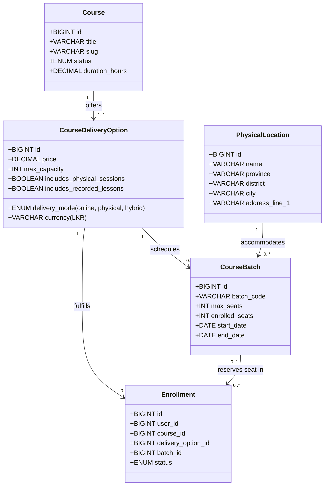

# LearnBuddy — System Architecture & Engineering Blueprint

## Document Metadata
* **System:** LearnBuddy Learning Management System (LMS)
* **Version:** 1.0 (Phase 2 Architecture & Design Specification)
* **Default Market:** Sri Lanka (Asia/Colombo, LKR)
* **Core Stack:** Laravel (Modular Monolith), PHP 8.5+, Tailwind CSS, Alpine.js, Aiven MySQL (SSL)

---

## 1. Modular Monolithic Architecture

LearnBuddy follows a modular monolithic architecture within standard Laravel conventions. The system separates responsibilities cleanly across layers to maintain high cohesion and low coupling without introducing the overhead of microservices or external frontend frameworks.

### A. Directory & Namespace Structure

```
app/
├── Http/
│   ├── Controllers/
│   │   ├── Admin/               # Filament-integrated & custom admin controllers
│   │   │   ├── CourseManagementController.php
│   │   │   ├── UserManagementController.php
│   │   │   ├── PhysicalBatchController.php
│   │   │   ├── PaymentAuditController.php
│   │   │   └── SystemSettingController.php
│   │   ├── Instructor/          # Authorized instructor workflows
│   │   │   ├── InstructorCourseController.php
│   │   │   ├── LessonContentController.php
│   │   │   ├── LiveClassScheduleController.php
│   │   │   ├── AttendanceController.php
│   │   │   └── AssignmentGradingController.php
│   │   ├── Student/             # Enrolled learner experiences
│   │   │   ├── DashboardController.php
│   │   │   ├── LearningPlayerController.php
│   │   │   ├── AssignmentSubmissionController.php
│   │   │   ├── QuizAttemptController.php
│   │   │   └── CertificateController.php
│   │   └── Public/              # Unauthenticated discovery & marketing
│   │       ├── HomeController.php
│   │       ├── CourseCatalogueController.php
│   │       ├── CourseDetailController.php
│   │       └── InstructorProfileController.php
│   ├── Requests/                # Form Requests for boundary validation
│   │   ├── Auth/
│   │   ├── Course/
│   │   ├── Batch/
│   │   ├── Enrollment/
│   │   ├── Assignment/
│   │   └── Quiz/
│   └── Middleware/              # HTTP boundary guards
│       ├── EnsureActiveEnrollment.php
│       ├── EnsureUserRole.php
│       ├── SetLocaleFromUser.php
│       └── SecurityHeadersMiddleware.php
├── Models/                      # 30 Singular Eloquent Models
│   ├── User.php
│   ├── Role.php
│   ├── Permission.php
│   ├── Category.php
│   ├── Course.php
│   ├── CourseInstructor.php
│   ├── CourseDeliveryOption.php
│   ├── CourseSection.php
│   ├── Lesson.php
│   ├── LessonResource.php
│   ├── PhysicalLocation.php
│   ├── CourseBatch.php
│   ├── BatchSchedule.php
│   ├── Enrollment.php
│   ├── Payment.php
│   ├── PaymentTransaction.php
│   ├── LiveClass.php
│   ├── Assignment.php
│   ├── AssignmentSubmission.php
│   ├── Quiz.php
│   ├── Question.php
│   ├── QuizOption.php
│   ├── QuizAttempt.php
│   ├── QuizAnswer.php
│   ├── LessonProgress.php
│   ├── Attendance.php
│   ├── Review.php
│   ├── Certificate.php
│   ├── Announcement.php
│   └── AuditLog.php
├── Policies/                    # Authorization gates & ownership checks
│   ├── CoursePolicy.php
│   ├── EnrollmentPolicy.php
│   ├── LessonPolicy.php
│   ├── LiveClassPolicy.php
│   ├── AssignmentPolicy.php
│   ├── QuizPolicy.php
│   ├── CertificatePolicy.php
│   └── AttendancePolicy.php
├── Services/                    # Justified multi-step business workflows
│   ├── Enrollment/
│   │   └── EnrollmentService.php       # Concurrency-safe seat reservation & activation
│   ├── Payments/
│   │   ├── Contracts/PaymentGatewayInterface.php
│   │   ├── PaymentService.php
│   │   └── Gateways/
│   │       ├── PayHereGateway.php      # Sri Lankan candidate gateway
│   │       ├── WebxpayGateway.php      # Sri Lankan candidate gateway
│   │       └── ManualBankSlipGateway.php
│   ├── Video/
│   │   ├── Contracts/VideoProviderInterface.php
│   │   └── Providers/MuxVideoProvider.php
│   ├── LiveClass/
│   │   ├── Contracts/LiveClassProviderInterface.php
│   │   └── Providers/JitsiLiveClassProvider.php
│   ├── Storage/
│   │   ├── Contracts/StorageServiceInterface.php
│   │   └── Providers/CloudflareR2StorageProvider.php
│   └── Notifications/
│       ├── Contracts/TransactionalEmailInterface.php
│       └── Providers/ResendEmailProvider.php
├── Enums/                       # Strongly-typed PHP 8.1+ String Enums
│   ├── UserRole.php             # Admin, Instructor, Student
│   ├── CourseStatus.php         # Draft, Review, Published, Archived
│   ├── DeliveryMode.php         # Online, Physical, Hybrid
│   ├── EnrollmentStatus.php     # PendingPayment, Active, Completed, Suspended, Cancelled
│   ├── PaymentStatus.php        # Pending, Completed, Failed, Refunded, Cancelled
│   ├── BatchStatus.php          # Upcoming, OpenForEnrollment, InProgress, Completed, Cancelled
│   ├── AttendanceStatus.php     # Present, Absent, Late, Excused
│   └── AssignmentStatus.php     # Submitted, UnderReview, Graded, ResubmissionRequired
├── Events/ & Listeners/         # Decoupled domain events (EnrollmentActivated, LiveClassScheduled)
├── Jobs/                        # Queued background jobs (GenerateCertificatePdf, DispatchReminderJob)
└── Notifications/               # Queued notifications (PaymentReceipt, LiveClassStartingNotification)
```

---

## 2. Request Lifecycle & Layer Responsibilities

```
[HTTP Request]
       │
       ▼
[Route with Middleware] (Auth, Throttling, Security Headers, Locale)
       │
       ▼
[Form Request Validation] (Boundary schema validation, strict type casting)
       │
       ▼
[Focused Controller] (Coordinates input/output, zero direct SQL or heavy logic)
       │
       ▼
[Policy / Gate Check] (Strict server-side authorization & ownership checks)
       │
       ▼
[Service Class] (If multi-step workflow: DB Transaction + Concurrency Lock)
       │
       ▼
[Eloquent Models / MySQL] (Decimals for money, foreign keys, compound indexes)
       │
       ▼
[Blade View Component / JSON Response] (Safely escaped HTML, no data leaks)
```

1. **Routes (`routes/web.php`):** Clean declarations with named routes and middleware groups. Business logic and raw queries are prohibited in routes.
2. **Controllers:** Keep thin ($< 50$ lines per method). Coordinate data retrieval, invoke service methods, and return Blade views or structured JSON responses.
3. **Form Requests:** Strictly validate data shape, presence, types, and constraints before controller execution.
4. **Policies:** Verify entity ownership and role authorization server-side (e.g. verifying an instructor owns the course before permitting lesson updates).
5. **Services:** Used exclusively for workflows that involve multi-table transactions, third-party integrations, or concurrency locking.

---

## 3. Role & Permission Matrix (Least Privilege)

| Capability / Entity | Administrator | Instructor | Student | Guest |
| :--- | :---: | :---: | :---: | :---: |
| Browse Published Courses & Details | Yes | Yes | Yes | Yes |
| Self-Registration & Login | Yes | Yes | Yes | Yes |
| Enroll in Free / Paid Courses | Yes | Yes | Yes | No |
| Access Enrolled Lessons & Resources | Yes | Yes (if assigned) | Yes (if active) | No |
| Watch Protected Video (Signed Token) | Yes | Yes (if assigned) | Yes (if active) | No |
| Join Scheduled Live Class | Yes | Host (if assigned) | Attend (if enrolled) | No |
| Submit Assignments & Take Quizzes | No | Preview | Yes (if enrolled) | No |
| Grade Submissions & Record Attendance | Yes | Yes (own courses) | No | No |
| Create / Edit Courses & Lessons | Yes | Yes (authorized) | No | No |
| Publish / Archive Courses | Yes | Request Review | No | No |
| Manage Physical Batches & Locations | Yes | View Assigned | View Enrolled | No |
| View System Financial Reports & Logs | Yes | Own Earnings Only | Own Invoices Only | No |
| Manage Global Settings & Tax Rates | Yes | No | No | No |

---

## 4. Multi-Delivery Course Architecture

A fundamental requirement of LearnBuddy is modeling a single course that can be delivered online, physically in a classroom, or as a hybrid program without duplicating the course record.



### Business Rules for Delivery Options
1. **Online Delivery:** Self-paced; unlimited capacity; immediate access upon enrollment activation.
2. **Physical Delivery:** Associated with a specific `course_batch` at a verified `physical_location`; seat capacity strictly enforced; physical schedule and attendance apply.
3. **Hybrid Delivery:** Grants access to online materials and assigns the learner to a physical classroom batch.

---

## 5. Safe Enrollment & Concurrency Handling

To eliminate overbooking and duplicate enrollment race conditions during high-demand course launches, enrollment execution must run inside an ACID database transaction using pessimistic locking:

```php
namespace App\Services\Enrollment;

use App\Models\CourseBatch;
use App\Models\CourseDeliveryOption;
use App\Models\Enrollment;
use App\Models\User;
use Illuminate\Support\Facades\DB;
use App\Exceptions\BatchFullException;
use App\Exceptions\AlreadyEnrolledException;

class EnrollmentService
{
    public function enrollStudent(User $user, CourseDeliveryOption $option, ?int $batchId = null): Enrollment
    {
        return DB::transaction(function () use ($user, $option, $batchId) {
            // 1. Guard against duplicate enrollment
            $existing = Enrollment::where('user_id', $user->id)
                ->where('course_id', $option->course_id)
                ->whereIn('status', ['active', 'pending_payment'])
                ->lockForUpdate()
                ->first();

            if ($existing) {
                throw new AlreadyEnrolledException("User is already enrolled in this course.");
            }

            // 2. Handle physical seat reservation with pessimistic locking
            $batch = null;
            if ($option->delivery_mode !== 'online' && $batchId) {
                $batch = CourseBatch::where('id', $batchId)
                    ->where('course_delivery_option_id', $option->id)
                    ->lockForUpdate()
                    ->firstOrFail();

                if ($batch->enrolled_seats >= $batch->max_seats) {
                    throw new BatchFullException("Selected physical batch has reached maximum seat capacity.");
                }

                $batch->increment('enrolled_seats');
            }

            // 3. Create enrollment record
            $status = $option->price > 0 ? 'pending_payment' : 'active';
            
            return Enrollment::create([
                'user_id' => $user->id,
                'course_id' => $option->course_id,
                'course_delivery_option_id' => $option->id,
                'course_batch_id' => $batch?->id,
                'enrolled_price' => $option->price,
                'currency' => $option->currency,
                'status' => $status,
                'enrolled_at' => $status === 'active' ? now() : null,
            ]);
        });
    }
}
```

---

## 6. Sri Lankan Context & Localization Blueprint

### A. Currency & Monetary Safety
* **Default Currency:** Sri Lankan Rupee (`LKR`).
* **Storage Type:** Strict `DECIMAL(12,2)`. Floating-point math (`float`, `double`) is prohibited in database fields and PHP calculations.
* **Calculations:** Handled via PHP's `bcmath` extension (`bcadd`, `bcsub`, `bcmul`, `bcdiv` with scale 2) to eliminate rounding drift.
* **Tax Architecture:** Tax rates (e.g. VAT, SSCL) and service charges are configurable via application configuration and settings, never hardcoded.

### B. Time Zone Standards
* **Storage Standard:** All timestamps stored uniformly in UTC.
* **Display Standard:** Converted to `Asia/Colombo` (+05:30) at the presentation layer using Carbon localization helpers.
* **Scheduling:** Class dates, reminders, batch start/end dates, and countdowns always evaluate against Sri Lanka Standard Time (SLST).

### C. Address Hierarchy
Sri Lankan addresses are modeled flexibly to avoid rigid assumptions while offering structured dropdowns for local governance divisions:
1. **Province:** Dropdown of 9 official provinces (Western, Central, Southern, Northern, Eastern, North Western, North Central, Uva, Sabaragamuwa).
2. **District:** Dropdown of 25 administrative districts (Colombo, Gampaha, Kalutara, Kandy, Matale, Nuwara Eliya, Galle, Matara, Hambantota, Jaffna, etc.).
3. **City / Town:** Text input supporting specific postal towns (e.g., Bambalapitiya, Maharagama, Peradeniya).
4. **Address Lines:** `address_line_1` (mandatory), `address_line_2` (optional).
5. **Postal Code:** Optional 5-digit local postal code.

### D. Telephone Validation
* **Formats Supported:** E.164 (`+947XXXXXXXX`), local mobile (`07XXXXXXXX`), and local landline (`011XXXXXXX`, `081XXXXXXX`).
* **Regex Pattern:** `/^(?:\+94|0)?(?:7[0-9]{8}|[1-9][0-9]{7,8})$/`
* **Internal Storage:** Normalized to E.164 (`+94771234567`) for SMS/WhatsApp gateway compatibility.

### E. Multi-Lingual Architecture
* **Launch Language:** English (`en`).
* **Preparation for Sinhala (`si`) & Tamil (`ta`):**
  * All views must use Laravel translation keys: `__('catalogue.filter_by')`, never raw English strings.
  * Translation files organized in `lang/{en,si,ta}/`:
    * `messages.php` (general UI text, navigation, footer)
    * `courses.php` (course categories, delivery modes, difficulties)
    * `auth.php` (login, registration, error alerts)
    * `validation.php` (form validation rules)

---

## 7. Replaceable Provider Service Interfaces

To avoid vendor lock-in and ensure commercial flexibility, all external services are bound to PHP interfaces:

### A. Payment Gateway Interface
```php
namespace App\Services\Payments\Contracts;

use App\Models\Payment;
use Illuminate\Http\Request;

interface PaymentGatewayInterface
{
    public function initiatePayment(Payment $payment): PaymentRedirectResponse;
    public function verifyWebhook(Request $request): PaymentWebhookResult;
    public function getProviderName(): string;
}
```

### B. Video Provider Interface (Mux Evaluated)
```php
namespace App\Services\Video\Contracts;

use App\Models\Lesson;
use App\Models\User;

interface VideoProviderInterface
{
    public function createDirectUploadUrl(): UploadEndpoint;
    public function generateSignedPlaybackToken(string $playbackId, User $user, int $ttlSeconds = 3600): string;
    public function processWebhook(array $payload, string $signature): VideoProcessingStatus;
}
```

### C. Live Class Provider Interface (Jitsi Evaluated)
```php
namespace App\Services\LiveClass\Contracts;

use App\Models\LiveClass;
use App\Models\User;

interface LiveClassProviderInterface
{
    public function createMeetingRoom(LiveClass $liveClass): MeetingRoomDetails;
    public function generateJoinToken(LiveClass $liveClass, User $user, bool $isModerator): string;
}
```

### D. Private Storage Interface (Cloudflare R2 Evaluated)
```php
namespace App\Services\Storage\Contracts;

interface StorageServiceInterface
{
    public function uploadPrivateFile(string $diskPath, $fileStream, string $mimeType): string;
    public function generateTemporaryDownloadUrl(string $diskPath, int $expirationMinutes = 15): string;
    public function deleteFile(string $diskPath): bool;
}
```

---

## 8. Application Security & Privacy Architecture

### A. OWASP Top 10 Safeguards
1. **Broken Object Level Authorization (IDOR):**
   * Every lesson video, assignment download, attendance submission, and quiz attempt must resolve through explicit Laravel Policies (`$this->authorize('view', $lesson)`).
   * URL route parameter tampering will return HTTP 403 Forbidden.
2. **Cryptographic Failures:**
   * Aiven MySQL SSL CA verification enforced via PDO parameters; unencrypted fallback disabled.
   * Passwords hashed using Argon2id or Bcrypt with cost factor 12.
3. **Injection Prevention:**
   * 100% parameter-bound queries via Eloquent / PDO.
   * Strict validation rules for file uploads (MIME type verification, safe randomly generated storage filenames).
4. **Security Misconfiguration:**
   * Production `APP_DEBUG=false`.
   * Secure session cookies: `SameSite=Lax`, `HttpOnly=true`, `Secure=true`.
5. **CSRF Protection:**
   * Enabled on all state-changing HTTP POST/PUT/DELETE routes via `@csrf` tokens.

### B. Sri Lanka Personal Data Protection Act (PDPA) Compliance Principles
* **Data Minimization:** Only collect personal information required for educational delivery, batch communication, and legal invoice generation.
* **Purpose Limitation:** Contact details collected for course delivery cannot be repurposed for external commercial advertising without consent.
* **Auditability:** All administrative modifications to user profiles, roles, enrollments, and payments are logged to `audit_logs` with actor ID, IP address, and timestamp.
* **Legal Disclaimer:** These engineering measures support technical data protection compliance; formal statutory legal certification must be reviewed by qualified legal counsel.
