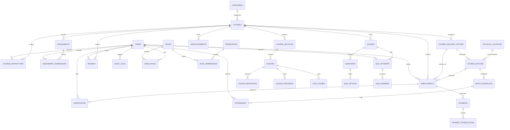

# LearnBuddy — Relational Database Architecture & Data Dictionary

## Database Engine & Deployment Details
* **Engine:** MySQL 8.0+
* **Primary Database Host:** Aiven Cloud MySQL (`mysql-3e258d69-fwvhaqc2992786-b39c.k.aivencloud.com:23001`)
* **Default Database:** `defaultdb`
* **Connection Security:** Mandatory SSL (`PDO::MYSQL_ATTR_SSL_CA`, `PDO::MYSQL_ATTR_SSL_VERIFY_SERVER_CERT = true`)
* **Collation / Charset:** `utf8mb4` / `utf8mb4_unicode_ci`

---

## 1. High-Level Entity-Relationship Overview

---

## 2. Complete Data Dictionary (30 Domain Entities)

### 1. `users`
Core user identity for students, instructors, and administrators.
* **Deletion Rule:** Soft delete (`deleted_at`) for audit compliance and historical enrollment preservation.

| Column | Type | Nullable | Default | Description & Constraints |
| :--- | :--- | :---: | :---: | :--- |
| `id` | `BIGINT UNSIGNED` | No | Auto Inc | Primary Key |
| `name` | `VARCHAR(255)` | No | | Full legal name |
| `email` | `VARCHAR(255)` | No | | Unique user email (`UNIQUE KEY`) |
| `email_verified_at` | `TIMESTAMP` | Yes | NULL | Verification timestamp |
| `password` | `VARCHAR(255)` | No | | Secure password hash (Argon2id/Bcrypt) |
| `phone` | `VARCHAR(30)` | Yes | NULL | Normalized E.164 phone (`+947XXXXXXXX`) |
| `phone_verified_at` | `TIMESTAMP` | Yes | NULL | Mobile verification timestamp |
| `avatar_url` | `VARCHAR(1024)` | Yes | NULL | Profile picture path |
| `bio` | `TEXT` | Yes | NULL | Short bio / instructor credentials |
| `province` | `VARCHAR(100)` | Yes | NULL | Sri Lankan province (Western, Central, etc.) |
| `district` | `VARCHAR(100)` | Yes | NULL | Sri Lankan district (Colombo, Kandy, etc.) |
| `city` | `VARCHAR(100)` | Yes | NULL | Postal town / city |
| `address_line_1` | `VARCHAR(255)` | Yes | NULL | Primary street address |
| `address_line_2` | `VARCHAR(255)` | Yes | NULL | Secondary address details |
| `postal_code` | `VARCHAR(20)` | Yes | NULL | Postal code |
| `locale` | `VARCHAR(10)` | No | `'en'` | Preferred UI language (`en`, `si`, `ta`) |
| `timezone` | `VARCHAR(50)` | No | `'Asia/Colombo'` | User time zone |
| `is_active` | `BOOLEAN` | No | `TRUE` | Account active flag |
| `two_factor_secret` | `TEXT` | Yes | NULL | Encrypted 2FA secret |
| `two_factor_recovery_codes` | `TEXT` | Yes | NULL | Encrypted backup codes |
| `two_factor_confirmed_at` | `TIMESTAMP` | Yes | NULL | 2FA activation timestamp |
| `remember_token` | `VARCHAR(100)` | Yes | NULL | Auth remember token |
| `created_at` | `TIMESTAMP` | No | | Record creation timestamp |
| `updated_at` | `TIMESTAMP` | No | | Record update timestamp |
| `deleted_at` | `TIMESTAMP` | Yes | NULL | Soft delete timestamp |

---

### 2. `roles` & `permissions` (RBAC)
Role-Based Access Control for least-privilege boundary enforcement.

#### Table: `roles`
| Column | Type | Nullable | Default | Constraints |
| :--- | :--- | :---: | :---: | :--- |
| `id` | `BIGINT UNSIGNED` | No | Auto Inc | Primary Key |
| `name` | `VARCHAR(50)` | No | | Unique role slug (`admin`, `instructor`, `student`) |
| `display_name` | `VARCHAR(100)` | No | | Human readable title |
| `description` | `VARCHAR(255)` | Yes | NULL | Role scope explanation |
| `created_at`, `updated_at` | `TIMESTAMP` | No | | Timestamps |

#### Table: `permissions`
| Column | Type | Nullable | Default | Constraints |
| :--- | :--- | :---: | :---: | :--- |
| `id` | `BIGINT UNSIGNED` | No | Auto Inc | Primary Key |
| `name` | `VARCHAR(100)` | No | | Unique permission slug (`courses.publish`, etc.) |
| `group` | `VARCHAR(50)` | No | | Group category (`courses`, `batches`, `finance`) |
| `description` | `VARCHAR(255)` | Yes | NULL | Description |
| `created_at`, `updated_at` | `TIMESTAMP` | No | | Timestamps |

#### Pivot Tables:
* `user_roles`: `user_id` (FK $\to$ `users.id` ON DELETE CASCADE), `role_id` (FK $\to$ `roles.id` ON DELETE CASCADE). Composite PK: `(user_id, role_id)`.
* `role_permissions`: `role_id` (FK $\to$ `roles.id` ON DELETE CASCADE), `permission_id` (FK $\to$ `permissions.id` ON DELETE CASCADE). Composite PK: `(role_id, permission_id)`.

---

### 3. `categories`
Hierarchical taxonomy for course classification.
* **Deletion Rule:** Restrict deletion if active courses exist.

| Column | Type | Nullable | Default | Constraints |
| :--- | :--- | :---: | :---: | :--- |
| `id` | `BIGINT UNSIGNED` | No | Auto Inc | Primary Key |
| `name` | `VARCHAR(100)` | No | | Category title (`UNIQUE`) |
| `slug` | `VARCHAR(120)` | No | | URL slug (`UNIQUE`) |
| `icon` | `VARCHAR(100)` | Yes | NULL | Icon class identifier |
| `description` | `TEXT` | Yes | NULL | Summary of category |
| `sort_order` | `INT UNSIGNED` | No | `0` | Visual display ordering |
| `is_active` | `BOOLEAN` | No | `TRUE` | Activation toggle |
| `created_at`, `updated_at` | `TIMESTAMP` | No | | Timestamps |

---

### 4. `courses`
Central educational offering. One course record serves all delivery modes.
* **Deletion Rule:** Soft delete (`deleted_at`). Restrict hard deletion if enrollments exist.

| Column | Type | Nullable | Default | Constraints |
| :--- | :--- | :---: | :---: | :--- |
| `id` | `BIGINT UNSIGNED` | No | Auto Inc | Primary Key |
| `category_id` | `BIGINT UNSIGNED` | No | | FK $\to$ `categories.id` ON DELETE RESTRICT |
| `title` | `VARCHAR(255)` | No | | Course title |
| `slug` | `VARCHAR(280)` | No | | Unique URL slug (`UNIQUE`) |
| `subtitle` | `VARCHAR(500)` | Yes | NULL | Catchy short tagline |
| `description` | `LONGTEXT` | No | | Detailed curriculum overview |
| `thumbnail_url` | `VARCHAR(1024)` | Yes | NULL | Course cover image |
| `preview_video_url` | `VARCHAR(1024)` | Yes | NULL | Public promo video URL |
| `difficulty_level` | `VARCHAR(30)` | No | `'all_levels'` | Enum: `beginner`, `intermediate`, `advanced`, `all_levels` |
| `language` | `VARCHAR(50)` | No | `'English'` | Instruction language |
| `duration_hours` | `DECIMAL(6,2)` | No | `0.00` | Estimated completion hours |
| `learning_outcomes` | `JSON` | Yes | NULL | Array of key takeaway bullet points |
| `prerequisites` | `JSON` | Yes | NULL | Array of required prior knowledge |
| `status` | `VARCHAR(30)` | No | `'draft'` | Enum: `draft`, `review`, `published`, `archived` |
| `published_at` | `TIMESTAMP` | Yes | NULL | First publication date |
| `created_by_user_id` | `BIGINT UNSIGNED` | No | | FK $\to$ `users.id` ON DELETE RESTRICT |
| `created_at`, `updated_at` | `TIMESTAMP` | No | | Timestamps |
| `deleted_at` | `TIMESTAMP` | Yes | NULL | Soft delete timestamp |

* **Indexes:** `status`, `category_id`, `created_at`, `difficulty_level`.

---

### 5. `course_instructors`
Pivot table supporting co-instructors and teaching assistants per course.

| Column | Type | Nullable | Default | Constraints |
| :--- | :--- | :---: | :---: | :--- |
| `id` | `BIGINT UNSIGNED` | No | Auto Inc | Primary Key |
| `course_id` | `BIGINT UNSIGNED` | No | | FK $\to$ `courses.id` ON DELETE CASCADE |
| `user_id` | `BIGINT UNSIGNED` | No | | FK $\to$ `users.id` ON DELETE RESTRICT |
| `is_primary` | `BOOLEAN` | No | `FALSE` | Primary lead instructor flag |
| `can_manage_content` | `BOOLEAN` | No | `TRUE` | Content editing privilege |
| `can_grade` | `BOOLEAN` | No | `TRUE` | Grading & attendance privilege |
| `created_at`, `updated_at` | `TIMESTAMP` | No | | Timestamps |

* **Unique Key:** `(course_id, user_id)`

---

### 6. `course_delivery_options`
Enables a single course to be offered Online, Physical, or Hybrid with distinct pricing.

| Column | Type | Nullable | Default | Constraints |
| :--- | :--- | :---: | :---: | :--- |
| `id` | `BIGINT UNSIGNED` | No | Auto Inc | Primary Key |
| `course_id` | `BIGINT UNSIGNED` | No | | FK $\to$ `courses.id` ON DELETE CASCADE |
| `delivery_mode` | `VARCHAR(30)` | No | | Enum: `online`, `physical`, `hybrid` |
| `title` | `VARCHAR(100)` | No | | e.g. "Online Self-Paced", "Classroom Weekend" |
| `description` | `TEXT` | Yes | NULL | Option specifics |
| `price` | `DECIMAL(12,2)` | No | `0.00` | Safe monetary price |
| `currency` | `VARCHAR(3)` | No | `'LKR'` | Default currency LKR |
| `is_free` | `BOOLEAN` | No | `FALSE` | True when price is 0.00 |
| `is_active` | `BOOLEAN` | No | `TRUE` | Availability status |
| `max_capacity` | `INT UNSIGNED` | Yes | NULL | NULL = unlimited; integer = limit |
| `access_period_days`| `INT UNSIGNED` | Yes | NULL | NULL = lifetime access |
| `includes_recorded_lessons` | `BOOLEAN` | No | `TRUE` | Access to on-demand videos |
| `includes_physical_sessions` | `BOOLEAN` | No | `FALSE` | Access to classroom batches |
| `includes_live_classes` | `BOOLEAN` | No | `FALSE` | Access to online interactive classes |
| `includes_certificate` | `BOOLEAN` | No | `TRUE` | Issue certificate on completion |
| `created_at`, `updated_at` | `TIMESTAMP` | No | | Timestamps |

* **Unique Key:** `(course_id, delivery_mode, title)`

---

### 7. `physical_locations`
Sri Lankan physical training centers, campuses, and classroom venues.

| Column | Type | Nullable | Default | Constraints |
| :--- | :--- | :---: | :---: | :--- |
| `id` | `BIGINT UNSIGNED` | No | Auto Inc | Primary Key |
| `name` | `VARCHAR(150)` | No | | e.g. "Colombo Campus - Lab 3" |
| `code` | `VARCHAR(50)` | No | | Unique location code (`UNIQUE`) |
| `province` | `VARCHAR(100)` | No | | Sri Lankan Province |
| `district` | `VARCHAR(100)` | No | | Sri Lankan District |
| `city` | `VARCHAR(100)` | No | | City / Town |
| `address_line_1` | `VARCHAR(255)` | No | | Street address |
| `address_line_2` | `VARCHAR(255)` | Yes | NULL | Suite / Floor |
| `postal_code` | `VARCHAR(20)` | Yes | NULL | Postal Code |
| `google_map_embed_url` | `TEXT` | Yes | NULL | Maps embed link |
| `contact_phone` | `VARCHAR(30)` | Yes | NULL | Campus telephone |
| `max_room_capacity` | `INT UNSIGNED` | No | `30` | Fire/safety seat capacity |
| `is_active` | `BOOLEAN` | No | `TRUE` | Active venue flag |
| `created_at`, `updated_at` | `TIMESTAMP` | No | | Timestamps |

---

### 8. `course_batches`
Scheduled intakes for physical classroom or cohort-based hybrid learning.

| Column | Type | Nullable | Default | Constraints |
| :--- | :--- | :---: | :---: | :--- |
| `id` | `BIGINT UNSIGNED` | No | Auto Inc | Primary Key |
| `course_delivery_option_id` | `BIGINT UNSIGNED` | No | | FK $\to$ `course_delivery_options.id` ON DELETE RESTRICT |
| `location_id` | `BIGINT UNSIGNED` | Yes | NULL | FK $\to$ `physical_locations.id` ON DELETE RESTRICT |
| `batch_code` | `VARCHAR(50)` | No | | Unique batch code (`UNIQUE`, e.g. "LB-COL-2026-B1") |
| `batch_name` | `VARCHAR(150)` | No | | e.g. "Weekend Morning Intake" |
| `max_seats` | `INT UNSIGNED` | No | | Maximum student capacity |
| `enrolled_seats` | `INT UNSIGNED` | No | `0` | Active reserved seat count |
| `registration_start_date` | `DATE` | No | | Enrollment opens |
| `registration_end_date` | `DATE` | No | | Enrollment closes |
| `start_date` | `DATE` | No | | First class session |
| `end_date` | `DATE` | No | | Final class session |
| `status` | `VARCHAR(30)` | No | `'upcoming'` | Enum: `upcoming`, `open_for_enrollment`, `in_progress`, `completed`, `cancelled` |
| `created_at`, `updated_at` | `TIMESTAMP` | No | | Timestamps |

* **Indexes:** `(course_delivery_option_id, status)`, `batch_code`.

---

### 9. `batch_schedules`
Weekly recurring timetable slots for classroom or live sessions.

| Column | Type | Nullable | Default | Constraints |
| :--- | :--- | :---: | :---: | :--- |
| `id` | `BIGINT UNSIGNED` | No | Auto Inc | Primary Key |
| `batch_id` | `BIGINT UNSIGNED` | No | | FK $\to$ `course_batches.id` ON DELETE CASCADE |
| `day_of_week` | `VARCHAR(20)` | No | | Enum: `monday`, `tuesday`, `wednesday`, `thursday`, `friday`, `saturday`, `sunday` |
| `start_time` | `TIME` | No | | Class start (SLST) |
| `end_time` | `TIME` | No | | Class end (SLST) |
| `room_number` | `VARCHAR(50)` | Yes | NULL | Classroom / Lab number |
| `notes` | `TEXT` | Yes | NULL | Preparation instructions |
| `created_at`, `updated_at` | `TIMESTAMP` | No | | Timestamps |

---

### 10. `course_sections`
Curriculum modules grouping lessons within a course.

| Column | Type | Nullable | Default | Constraints |
| :--- | :--- | :---: | :---: | :--- |
| `id` | `BIGINT UNSIGNED` | No | Auto Inc | Primary Key |
| `course_id` | `BIGINT UNSIGNED` | No | | FK $\to$ `courses.id` ON DELETE CASCADE |
| `title` | `VARCHAR(255)` | No | | Module title |
| `description` | `TEXT` | Yes | NULL | Module summary |
| `sort_order` | `INT UNSIGNED` | No | `0` | Sequential sort position |
| `is_published` | `BOOLEAN` | No | `TRUE` | Section visibility |
| `created_at`, `updated_at` | `TIMESTAMP` | No | | Timestamps |

* **Index:** `(course_id, sort_order)`

---

### 11. `lessons`
Individual learning units (Video, Article, Quiz link, Assignment link).

| Column | Type | Nullable | Default | Constraints |
| :--- | :--- | :---: | :---: | :--- |
| `id` | `BIGINT UNSIGNED` | No | Auto Inc | Primary Key |
| `section_id` | `BIGINT UNSIGNED` | No | | FK $\to$ `course_sections.id` ON DELETE CASCADE |
| `title` | `VARCHAR(255)` | No | | Lesson title |
| `slug` | `VARCHAR(280)` | No | | Slug within module |
| `type` | `VARCHAR(30)` | No | `'video'` | Enum: `video`, `article`, `live_class`, `quiz`, `assignment` |
| `content` | `LONGTEXT` | Yes | NULL | Lesson text/notes in Markdown |
| `video_provider` | `VARCHAR(50)` | Yes | NULL | `'mux'`, `'local'` |
| `video_asset_id` | `VARCHAR(255)` | Yes | NULL | Private provider asset ID |
| `video_playback_id`| `VARCHAR(255)` | Yes | NULL | Private playback identifier |
| `duration_minutes` | `INT UNSIGNED` | No | `0` | Lesson runtime |
| `sort_order` | `INT UNSIGNED` | No | `0` | Display order |
| `is_preview` | `BOOLEAN` | No | `FALSE` | Public previewable flag |
| `is_published` | `BOOLEAN` | No | `TRUE` | Published toggle |
| `created_at`, `updated_at` | `TIMESTAMP` | No | | Timestamps |

* **Unique Key:** `(section_id, slug)`
* **Index:** `(section_id, sort_order)`

---

### 12. `lesson_resources`
Downloadable assets attached to a lesson (e.g., source code, slide decks, PDF guides).

| Column | Type | Nullable | Default | Constraints |
| :--- | :--- | :---: | :---: | :--- |
| `id` | `BIGINT UNSIGNED` | No | Auto Inc | Primary Key |
| `lesson_id` | `BIGINT UNSIGNED` | No | | FK $\to$ `lessons.id` ON DELETE CASCADE |
| `title` | `VARCHAR(255)` | No | | Resource display name |
| `file_path` | `VARCHAR(1024)` | No | | Private Cloudflare R2 / S3 path |
| `file_name` | `VARCHAR(255)` | No | | Original filename |
| `file_size_bytes` | `BIGINT UNSIGNED` | No | | Exact file size |
| `mime_type` | `VARCHAR(100)` | No | | MIME type verification |
| `download_count` | `INT UNSIGNED` | No | `0` | Counter |
| `created_at`, `updated_at` | `TIMESTAMP` | No | | Timestamps |

---

### 13. `enrollments`
Binds a student to a course under a specific delivery mode and optional physical batch.
* **Deletion Rule:** Restrict deletion if payments or progress records exist. Use status `cancelled` or `suspended`.

| Column | Type | Nullable | Default | Constraints |
| :--- | :--- | :---: | :---: | :--- |
| `id` | `BIGINT UNSIGNED` | No | Auto Inc | Primary Key |
| `user_id` | `BIGINT UNSIGNED` | No | | FK $\to$ `users.id` ON DELETE RESTRICT |
| `course_id` | `BIGINT UNSIGNED` | No | | FK $\to$ `courses.id` ON DELETE RESTRICT |
| `course_delivery_option_id` | `BIGINT UNSIGNED` | No | | FK $\to$ `course_delivery_options.id` ON DELETE RESTRICT |
| `course_batch_id` | `BIGINT UNSIGNED` | Yes | NULL | FK $\to$ `course_batches.id` ON DELETE RESTRICT |
| `enrolled_price` | `DECIMAL(12,2)` | No | `0.00` | Price agreed at checkout |
| `currency` | `VARCHAR(3)` | No | `'LKR'` | Currency |
| `status` | `VARCHAR(30)` | No | `'pending_payment'` | Enum: `pending_payment`, `active`, `completed`, `suspended`, `cancelled` |
| `enrolled_at` | `TIMESTAMP` | Yes | NULL | Activation timestamp |
| `expires_at` | `TIMESTAMP` | Yes | NULL | Expiration (NULL = lifetime) |
| `progress_percentage` | `DECIMAL(5,2)` | No | `0.00` | Calculated course completion |
| `created_at`, `updated_at` | `TIMESTAMP` | No | | Timestamps |

* **Unique Key:** `(user_id, course_id)` — **Prevents duplicate enrollment.**
* **Indexes:** `(user_id, status)`, `(course_batch_id, status)`.

---

### 14. `payments`
Provider-independent orders and invoices.

| Column | Type | Nullable | Default | Constraints |
| :--- | :--- | :---: | :---: | :--- |
| `id` | `BIGINT UNSIGNED` | No | Auto Inc | Primary Key |
| `invoice_number` | `VARCHAR(50)` | No | | Unique commercial invoice number (`UNIQUE`) |
| `user_id` | `BIGINT UNSIGNED` | No | | FK $\to$ `users.id` ON DELETE RESTRICT |
| `enrollment_id` | `BIGINT UNSIGNED` | No | | FK $\to$ `enrollments.id` ON DELETE RESTRICT |
| `subtotal` | `DECIMAL(12,2)` | No | | Course price before tax |
| `tax_amount` | `DECIMAL(12,2)` | No | `0.00` | Sri Lankan VAT / SSCL |
| `service_charge` | `DECIMAL(12,2)` | No | `0.00` | Administrative charge |
| `total_amount` | `DECIMAL(12,2)` | No | | Total payable in LKR |
| `currency` | `VARCHAR(3)` | No | `'LKR'` | LKR |
| `status` | `VARCHAR(30)` | No | `'pending'` | Enum: `pending`, `completed`, `failed`, `refunded`, `cancelled` |
| `payment_method` | `VARCHAR(50)` | Yes | NULL | `payhere`, `webxpay`, `bank_slip`, `free` |
| `paid_at` | `TIMESTAMP` | Yes | NULL | Successful payment confirmation |
| `created_at`, `updated_at` | `TIMESTAMP` | No | | Timestamps |

* **Indexes:** `(user_id, status)`, `invoice_number`.

---

### 15. `payment_transactions`
Audit trail of gateway responses, webhooks, and IPNs.

| Column | Type | Nullable | Default | Constraints |
| :--- | :--- | :---: | :---: | :--- |
| `id` | `BIGINT UNSIGNED` | No | Auto Inc | Primary Key |
| `payment_id` | `BIGINT UNSIGNED` | No | | FK $\to$ `payments.id` ON DELETE CASCADE |
| `gateway` | `VARCHAR(50)` | No | | Provider name (`payhere`, `webxpay`) |
| `transaction_reference` | `VARCHAR(150)` | No | | Unique reference code (`UNIQUE`) |
| `gateway_payment_id`| `VARCHAR(150)` | Yes | NULL | External transaction ID |
| `amount` | `DECIMAL(12,2)` | No | | Verified amount |
| `currency` | `VARCHAR(3)` | No | `'LKR'` | Verified currency |
| `status_code` | `VARCHAR(50)` | No | | Raw gateway status code |
| `raw_payload` | `JSON` | No | | Full webhook payload for audit |
| `signature_verified`| `BOOLEAN` | No | `FALSE` | Cryptographic signature validity |
| `ip_address` | `VARCHAR(45)` | Yes | NULL | Originating webhook IP address |
| `created_at`, `updated_at` | `TIMESTAMP` | No | | Timestamps |

* **Index:** `(payment_id)`, `transaction_reference`.

---

### 16. `live_classes`
Scheduled interactive video sessions (e.g., Jitsi Meet integration).

| Column | Type | Nullable | Default | Constraints |
| :--- | :--- | :---: | :---: | :--- |
| `id` | `BIGINT UNSIGNED` | No | Auto Inc | Primary Key |
| `course_id` | `BIGINT UNSIGNED` | No | | FK $\to$ `courses.id` ON DELETE CASCADE |
| `lesson_id` | `BIGINT UNSIGNED` | Yes | NULL | FK $\to$ `lessons.id` ON DELETE SET NULL |
| `batch_id` | `BIGINT UNSIGNED` | Yes | NULL | FK $\to$ `course_batches.id` ON DELETE SET NULL |
| `instructor_id` | `BIGINT UNSIGNED` | No | | FK $\to$ `users.id` ON DELETE RESTRICT |
| `title` | `VARCHAR(255)` | No | | Session title |
| `description` | `TEXT` | Yes | NULL | Agenda & topics |
| `provider` | `VARCHAR(50)` | No | `'jitsi'` | Video provider |
| `meeting_identifier`| `VARCHAR(255)` | No | | Unique secure room UUID |
| `meeting_password` | `VARCHAR(255)` | Yes | NULL | Hashed moderator password |
| `scheduled_start_time` | `TIMESTAMP` | No | | Planned start (UTC) |
| `scheduled_end_time` | `TIMESTAMP` | No | | Planned end (UTC) |
| `actual_start_time` | `TIMESTAMP` | Yes | NULL | Host arrival timestamp |
| `actual_end_time` | `TIMESTAMP` | Yes | NULL | Host closure timestamp |
| `status` | `VARCHAR(30)` | No | `'scheduled'` | Enum: `scheduled`, `live`, `completed`, `cancelled` |
| `created_at`, `updated_at` | `TIMESTAMP` | No | | Timestamps |

* **Indexes:** `(course_id, scheduled_start_time)`, `(instructor_id, status)`.

---

### 17. `assignments`
Coursework prompts and assessment guidelines.

| Column | Type | Nullable | Default | Constraints |
| :--- | :--- | :---: | :---: | :--- |
| `id` | `BIGINT UNSIGNED` | No | Auto Inc | Primary Key |
| `course_id` | `BIGINT UNSIGNED` | No | | FK $\to$ `courses.id` ON DELETE CASCADE |
| `lesson_id` | `BIGINT UNSIGNED` | Yes | NULL | FK $\to$ `lessons.id` ON DELETE SET NULL |
| `title` | `VARCHAR(255)` | No | | Assignment title |
| `description` | `LONGTEXT` | No | | Detailed assignment brief |
| `max_score` | `INT UNSIGNED` | No | `100` | Total possible points |
| `pass_score` | `INT UNSIGNED` | No | `50` | Passing threshold |
| `due_date` | `TIMESTAMP` | Yes | NULL | Deadline (UTC) |
| `allowed_extensions` | `VARCHAR(255)` | No | `'pdf,zip,doc,docx'` | Permitted file types |
| `max_file_size_mb` | `INT UNSIGNED` | No | `20` | Max upload size limit |
| `is_published` | `BOOLEAN` | No | `TRUE` | Published toggle |
| `created_at`, `updated_at` | `TIMESTAMP` | No | | Timestamps |

---

### 18. `assignment_submissions`
Student submissions, instructor marks, and feedback.

| Column | Type | Nullable | Default | Constraints |
| :--- | :--- | :---: | :---: | :--- |
| `id` | `BIGINT UNSIGNED` | No | Auto Inc | Primary Key |
| `assignment_id` | `BIGINT UNSIGNED` | No | | FK $\to$ `assignments.id` ON DELETE CASCADE |
| `user_id` | `BIGINT UNSIGNED` | No | | FK $\to$ `users.id` ON DELETE RESTRICT |
| `file_path` | `VARCHAR(1024)` | No | | Private R2 object path |
| `file_name` | `VARCHAR(255)` | No | | Original uploaded filename |
| `student_notes` | `TEXT` | Yes | NULL | Student comments |
| `submitted_at` | `TIMESTAMP` | No | | Submission timestamp |
| `score` | `INT UNSIGNED` | Yes | NULL | Awarded score |
| `graded_by_user_id` | `BIGINT UNSIGNED` | Yes | NULL | FK $\to$ `users.id` ON DELETE SET NULL |
| `graded_at` | `TIMESTAMP` | Yes | NULL | Grading timestamp |
| `instructor_feedback` | `TEXT` | Yes | NULL | Written feedback |
| `status` | `VARCHAR(30)` | No | `'submitted'` | Enum: `submitted`, `under_review`, `graded`, `resubmission_required` |
| `created_at`, `updated_at` | `TIMESTAMP` | No | | Timestamps |

* **Unique Key:** `(assignment_id, user_id)`
* **Index:** `(user_id, status)`

---

### 19. `quizzes`
Evaluative tests and automated assessments.

| Column | Type | Nullable | Default | Constraints |
| :--- | :--- | :---: | :---: | :--- |
| `id` | `BIGINT UNSIGNED` | No | Auto Inc | Primary Key |
| `course_id` | `BIGINT UNSIGNED` | No | | FK $\to$ `courses.id` ON DELETE CASCADE |
| `lesson_id` | `BIGINT UNSIGNED` | Yes | NULL | FK $\to$ `lessons.id` ON DELETE SET NULL |
| `title` | `VARCHAR(255)` | No | | Quiz title |
| `description` | `TEXT` | Yes | NULL | Quiz instructions |
| `time_limit_minutes`| `INT UNSIGNED` | Yes | NULL | NULL = untimed |
| `pass_percentage` | `INT UNSIGNED` | No | `70` | Passing score requirement |
| `max_attempts` | `INT UNSIGNED` | No | `3` | 0 = unlimited |
| `is_randomized` | `BOOLEAN` | No | `TRUE` | Shuffle question order |
| `is_published` | `BOOLEAN` | No | `TRUE` | Published toggle |
| `created_at`, `updated_at` | `TIMESTAMP` | No | | Timestamps |

---

### 20. `questions`
Questions linked to a quiz.

| Column | Type | Nullable | Default | Constraints |
| :--- | :--- | :---: | :---: | :--- |
| `id` | `BIGINT UNSIGNED` | No | Auto Inc | Primary Key |
| `quiz_id` | `BIGINT UNSIGNED` | No | | FK $\to$ `quizzes.id` ON DELETE CASCADE |
| `question_text` | `TEXT` | No | | Question text |
| `question_type` | `VARCHAR(30)` | No | `'single_choice'` | Enum: `single_choice`, `multiple_choice`, `true_false` |
| `points` | `INT UNSIGNED` | No | `1` | Point weight |
| `explanation` | `TEXT` | Yes | NULL | Post-submission explanation |
| `sort_order` | `INT UNSIGNED` | No | `0` | Sequence |
| `created_at`, `updated_at` | `TIMESTAMP` | No | | Timestamps |

---

### 21. `quiz_options`
Choices for quiz questions. Correct answer flags are strictly kept server-side.

| Column | Type | Nullable | Default | Constraints |
| :--- | :--- | :---: | :---: | :--- |
| `id` | `BIGINT UNSIGNED` | No | Auto Inc | Primary Key |
| `question_id` | `BIGINT UNSIGNED` | No | | FK $\to$ `questions.id` ON DELETE CASCADE |
| `option_text` | `TEXT` | No | | Option label |
| `is_correct` | `BOOLEAN` | No | `FALSE` | Hidden from student API until graded |
| `sort_order` | `INT UNSIGNED` | No | `0` | Order |
| `created_at`, `updated_at` | `TIMESTAMP` | No | | Timestamps |

---

### 22. `quiz_attempts`
Records of a student taking a quiz.

| Column | Type | Nullable | Default | Constraints |
| :--- | :--- | :---: | :---: | :--- |
| `id` | `BIGINT UNSIGNED` | No | Auto Inc | Primary Key |
| `quiz_id` | `BIGINT UNSIGNED` | No | | FK $\to$ `quizzes.id` ON DELETE CASCADE |
| `user_id` | `BIGINT UNSIGNED` | No | | FK $\to$ `users.id` ON DELETE RESTRICT |
| `attempt_number` | `INT UNSIGNED` | No | | Sequential attempt (1, 2, 3...) |
| `total_score` | `DECIMAL(5,2)` | No | `0.00` | Points earned |
| `score_percentage` | `DECIMAL(5,2)` | No | `0.00` | Percentage score |
| `is_passed` | `BOOLEAN` | No | `FALSE` | True if $\ge \text{pass\_percentage}$ |
| `started_at` | `TIMESTAMP` | No | | Attempt start timestamp |
| `completed_at` | `TIMESTAMP` | Yes | NULL | Attempt submission timestamp |
| `created_at`, `updated_at` | `TIMESTAMP` | No | | Timestamps |

* **Unique Key:** `(quiz_id, user_id, attempt_number)`

---

### 23. `quiz_answers`
Granular selections for each question within an attempt.

| Column | Type | Nullable | Default | Constraints |
| :--- | :--- | :---: | :---: | :--- |
| `id` | `BIGINT UNSIGNED` | No | Auto Inc | Primary Key |
| `attempt_id` | `BIGINT UNSIGNED` | No | | FK $\to$ `quiz_attempts.id` ON DELETE CASCADE |
| `question_id` | `BIGINT UNSIGNED` | No | | FK $\to$ `questions.id` ON DELETE CASCADE |
| `selected_option_id`| `BIGINT UNSIGNED` | Yes | NULL | FK $\to$ `quiz_options.id` ON DELETE SET NULL |
| `is_correct` | `BOOLEAN` | No | `FALSE` | Evaluated result |
| `points_awarded` | `INT UNSIGNED` | No | `0` | Score awarded |
| `created_at`, `updated_at` | `TIMESTAMP` | No | | Timestamps |

* **Unique Key:** `(attempt_id, question_id)`

---

### 24. `lesson_progress`
Granular lesson completion tracking for students.

| Column | Type | Nullable | Default | Constraints |
| :--- | :--- | :---: | :---: | :--- |
| `id` | `BIGINT UNSIGNED` | No | Auto Inc | Primary Key |
| `user_id` | `BIGINT UNSIGNED` | No | | FK $\to$ `users.id` ON DELETE RESTRICT |
| `lesson_id` | `BIGINT UNSIGNED` | No | | FK $\to$ `lessons.id` ON DELETE CASCADE |
| `is_completed` | `BOOLEAN` | No | `FALSE` | Finished toggle |
| `last_watched_seconds` | `INT UNSIGNED` | No | `0` | Video playback resume position |
| `completed_at` | `TIMESTAMP` | Yes | NULL | Finish timestamp |
| `created_at`, `updated_at` | `TIMESTAMP` | No | | Timestamps |

* **Unique Key:** `(user_id, lesson_id)`
* **Index:** `(user_id, is_completed)`

---

### 25. `attendance`
Session-by-session roll call for physical classroom batches.

| Column | Type | Nullable | Default | Constraints |
| :--- | :--- | :---: | :---: | :--- |
| `id` | `BIGINT UNSIGNED` | No | Auto Inc | Primary Key |
| `batch_id` | `BIGINT UNSIGNED` | No | | FK $\to$ `course_batches.id` ON DELETE CASCADE |
| `schedule_id` | `BIGINT UNSIGNED` | No | | FK $\to$ `batch_schedules.id` ON DELETE RESTRICT |
| `enrollment_id` | `BIGINT UNSIGNED` | No | | FK $\to$ `enrollments.id` ON DELETE RESTRICT |
| `user_id` | `BIGINT UNSIGNED` | No | | FK $\to$ `users.id` ON DELETE RESTRICT |
| `session_date` | `DATE` | No | | Class calendar date |
| `status` | `VARCHAR(20)` | No | `'present'` | Enum: `present`, `absent`, `late`, `excused` |
| `remarks` | `VARCHAR(255)` | Yes | NULL | Instructor notes |
| `recorded_by_user_id` | `BIGINT UNSIGNED` | No | | FK $\to$ `users.id` ON DELETE RESTRICT |
| `created_at`, `updated_at` | `TIMESTAMP` | No | | Timestamps |

* **Unique Key:** `(schedule_id, enrollment_id, session_date)`

---

### 26. `reviews`
Verified student reviews and 5-star ratings.
* **Integrity Rule:** Only students with active/completed enrollments can leave a review.

| Column | Type | Nullable | Default | Constraints |
| :--- | :--- | :---: | :---: | :--- |
| `id` | `BIGINT UNSIGNED` | No | Auto Inc | Primary Key |
| `course_id` | `BIGINT UNSIGNED` | No | | FK $\to$ `courses.id` ON DELETE CASCADE |
| `user_id` | `BIGINT UNSIGNED` | No | | FK $\to$ `users.id` ON DELETE RESTRICT |
| `rating` | `TINYINT UNSIGNED` | No | | Integer 1 to 5 |
| `review_title` | `VARCHAR(150)` | Yes | NULL | Review headline |
| `comment` | `TEXT` | No | | Review body |
| `is_approved` | `BOOLEAN` | No | `FALSE` | Moderation queue flag |
| `approved_by_user_id` | `BIGINT UNSIGNED` | Yes | NULL | FK $\to$ `users.id` ON DELETE SET NULL |
| `created_at`, `updated_at` | `TIMESTAMP` | No | | Timestamps |

* **Unique Key:** `(course_id, user_id)` (One review per student per course)
* **Index:** `(course_id, is_approved, rating)`

---

### 27. `certificates`
Cryptographically verifiable completion certificates.

| Column | Type | Nullable | Default | Constraints |
| :--- | :--- | :---: | :---: | :--- |
| `id` | `BIGINT UNSIGNED` | No | Auto Inc | Primary Key |
| `certificate_code` | `VARCHAR(50)` | No | | Unique code (`UNIQUE`, e.g. "LB-CERT-2026-X9Y2") |
| `user_id` | `BIGINT UNSIGNED` | No | | FK $\to$ `users.id` ON DELETE RESTRICT |
| `course_id` | `BIGINT UNSIGNED` | No | | FK $\to$ `courses.id` ON DELETE RESTRICT |
| `enrollment_id` | `BIGINT UNSIGNED` | No | | FK $\to$ `enrollments.id` ON DELETE RESTRICT |
| `issue_date` | `DATE` | No | | Date of qualification |
| `verification_hash`| `VARCHAR(64)` | No | | SHA-256 hash for public QR verification (`UNIQUE`) |
| `pdf_path` | `VARCHAR(1024)` | Yes | NULL | Generated certificate PDF on R2 storage |
| `is_revoked` | `BOOLEAN` | No | `FALSE` | Revocation flag |
| `revoked_reason` | `VARCHAR(255)` | Yes | NULL | Reason for revocation |
| `created_at`, `updated_at` | `TIMESTAMP` | No | | Timestamps |

* **Unique Key:** `(user_id, course_id)`

---

### 28. `notifications`
Laravel polymorphic in-app notifications.

| Column | Type | Nullable | Default | Constraints |
| :--- | :--- | :---: | :---: | :--- |
| `id` | `CHAR(36)` | No | | UUID Primary Key |
| `type` | `VARCHAR(255)` | No | | Notification class name |
| `notifiable_type`| `VARCHAR(255)` | No | | Target model type (`App\Models\User`) |
| `notifiable_id` | `BIGINT UNSIGNED` | No | | Target user ID |
| `data` | `JSON` | No | | Payload (message, route, icon, action URL) |
| `read_at` | `TIMESTAMP` | Yes | NULL | Read state timestamp |
| `created_at`, `updated_at` | `TIMESTAMP` | No | | Timestamps |

* **Index:** `(notifiable_type, notifiable_id, read_at)`

---

### 29. `announcements`
Broadcast updates from instructors/admins to enrolled students.

| Column | Type | Nullable | Default | Constraints |
| :--- | :--- | :---: | :---: | :--- |
| `id` | `BIGINT UNSIGNED` | No | Auto Inc | Primary Key |
| `course_id` | `BIGINT UNSIGNED` | No | | FK $\to$ `courses.id` ON DELETE CASCADE |
| `user_id` | `BIGINT UNSIGNED` | No | | Author ID (FK $\to$ `users.id` ON DELETE RESTRICT) |
| `title` | `VARCHAR(255)` | No | | Headline |
| `content` | `TEXT` | No | | Announcement body |
| `send_email_notification` | `BOOLEAN` | No | `TRUE` | Email dispatch toggle |
| `created_at`, `updated_at` | `TIMESTAMP` | No | | Timestamps |

* **Index:** `(course_id, created_at)`

---

### 30. `audit_logs`
Tamper-resistant security and administrative audit trail.
* **Deletion Rule:** Never deleted.

| Column | Type | Nullable | Default | Constraints |
| :--- | :--- | :---: | :---: | :--- |
| `id` | `BIGINT UNSIGNED` | No | Auto Inc | Primary Key |
| `user_id` | `BIGINT UNSIGNED` | Yes | NULL | Actor (FK $\to$ `users.id` ON DELETE SET NULL) |
| `action` | `VARCHAR(100)` | No | | Action slug (e.g. `course.published`, `payment.webhook`) |
| `auditable_type` | `VARCHAR(100)` | No | | Subject model class name |
| `auditable_id` | `BIGINT UNSIGNED` | No | | Subject model ID |
| `old_values` | `JSON` | Yes | NULL | Previous state |
| `new_values` | `JSON` | Yes | NULL | Modified state |
| `ip_address` | `VARCHAR(45)` | Yes | NULL | IPv4 / IPv6 client address |
| `user_agent` | `TEXT` | Yes | NULL | Client browser agent |
| `created_at` | `TIMESTAMP` | No | CURRENT_TIMESTAMP | Event log timestamp |

* **Indexes:** `(auditable_type, auditable_id)`, `(user_id, action)`, `created_at`.
